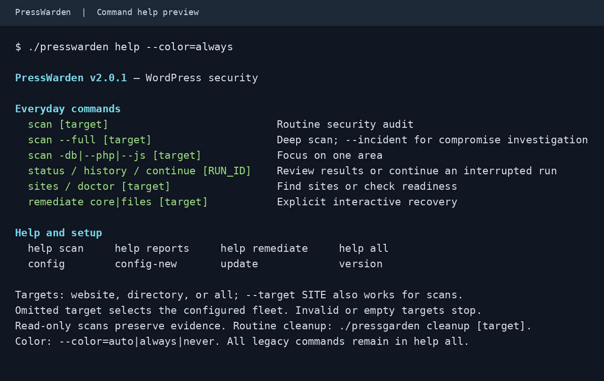

# Everyday command guide

The main scan entrypoint is `scan`. Commands from earlier releases still work.

| Task | Command |
|---|---|
| Routine security audit | `presswarden scan example.com` |
| Deep audit | `presswarden scan --full example.com` |
| Incident investigation | `presswarden scan --incident example.com` |
| Database threats and persistence | `presswarden scan -db example.com` |
| Focused PHP threat recheck | `presswarden scan --php example.com` |
| Focused JavaScript recheck | `presswarden scan --js example.com` |
| Local PHP persistence directives | `presswarden scan --runtime example.com` |
| Latest security run | `presswarden status` |
| Finding history | `presswarden history` |
| Continue an interrupted compatible run | `presswarden continue RUN_ID` |

`--deep` is an alias of `--full`; `-db` and `--db` are equivalent. Choose one scan
mode per invocation. The database selector runs the existing database security
suite. The legacy `inspect db` command remains available for its narrower
database-malware-only recheck.

## Targets

Use either a positional website/directory or `--target SITE` / `--target=SITE`.
Selectors may go before or after a positional target:

```bash
./presswarden scan example.com --full
./presswarden scan --php --target example.com/shop
./presswarden full --target example.com
```

Omission selects the configured fleet, as before. Explicit `all` selects that
fleet too. Empty, unknown, excluded, ambiguous or duplicate targets stop with
exit 2. A bad option never turns into an omitted target; a presentation flag
immediately after `--target` is refused as a missing/invalid value. Narrowing to one site
retains nested-site exclusions. Target resolution does not bootstrap WordPress.
Actual database and runtime checks may still load WordPress through WP-CLI.

## Configuration and readiness

Start with [the installation and first-scan walkthrough](../README.md#install).
`config` displays effective private paths, including a separately configured
reports directory, without displaying tokens. Root-validation failures return
exit 2 instead of displaying a successful table with an empty root.

Saved configuration is trusted shell code. Existing unreadable/nonregular files,
broken links, syntax errors and unsuccessful loading stop with exit 2 before a
check can fall back to default scope. `config-new` remains available without
loading that file. Exported settings override saved assignments; multiline
values such as exclusion lists are preserved exactly. A saved readonly setting
that prevents an exported override is an error.

`doctor --target SITE` checks local readiness. A configured WPScan/YARA provider
with missing local dependencies produces a review and exit 1. Provider presence
does not establish valid credentials, API quota or complete scan coverage;
doctor does not invoke those external scanners. An empty discovered inventory
also needs review. Required dependency or distributed-script syntax failures
return exit 2.

## Reading saved results

`status`/`run-status` and `history` default to the latest suite run. Before the
first run, they print a clear empty-state message and return 0 without creating
state. Explicitly empty, invalid or unrecorded run IDs return 2. An interrupted
run without finalized finding history is incomplete, not an empty history.

Use the run identifier and console-report path printed by the suite to inspect
the details. Displaying a saved record successfully does not mean its recorded
scan completed cleanly. See [reports and run IDs](../README.md#reports-and-run-ids)
for continuation and finding-state meanings.

## Color and help

`help` shows everyday commands, while `help all` retains the complete reference.
Use `help scan`, `help reports`, `help remediate`, `help setup`, or `help intel`
for a specific task. `update --help` shows instructions without running an update.



Command help preview rendered from actual `./presswarden help --color=always`
output. The preview contains no website or client data.

Automatic color uses stdout's terminal state. Redirected output is plain, even
if stderr is attached to a terminal. Explicit forcing is available for a terminal
viewer or a color-aware capture:

```bash
./presswarden help --color=always
./presswarden scan --php example.com --color=never
NO_COLOR=1 ./presswarden help
```

`--color=auto|always|never` and `--no-color` affect presentation only. A non-empty
`NO_COLOR` or `PRESSWARDEN_NOCOLOR` disables color, including explicit forcing.
`PRESSWARDEN_COLOR` supports the same modes in configuration or environment.
Existing suite pipelines preserve colored live output when the caller has a
terminal; the reports and exit-code contracts are unchanged.

## Maintenance and recovery

Routine cleanup belongs to the standalone PressGarden application. Its main
`cleanup` command previews routine cleanup categories, with `-db` and `-logs`
selectors to narrow the selection. PressWarden's former maintenance commands
print that direction, return exit 2, and never run a sibling application.

Security evidence, quarantine and recovery remain explicit. Ordinary scans never
delete website files or approve remediation. Use `help remediate` for the existing
interactive operations. This command consolidation does not change retention,
quarantine rules, independent configuration/state, or production deployment.

## Included scanner fixes

Version 2.0.2 includes the scanner/evidence work from PR #34 at
`9fad6dd4f4eb22ec971cab1db76df248b219f96d`, including PR #33. Original review
branches are untouched. The inherited work addresses static-core boundaries,
optional scanner completeness, preserved partial findings and inert report
display; see [scanner coverage](SCANNER-COVERAGE.md) and
[the original refinement record](REFINEMENT.md). This release adds public CLI
routing and terminal-output regression coverage. Its verified source publication
does not run operations on production websites.
